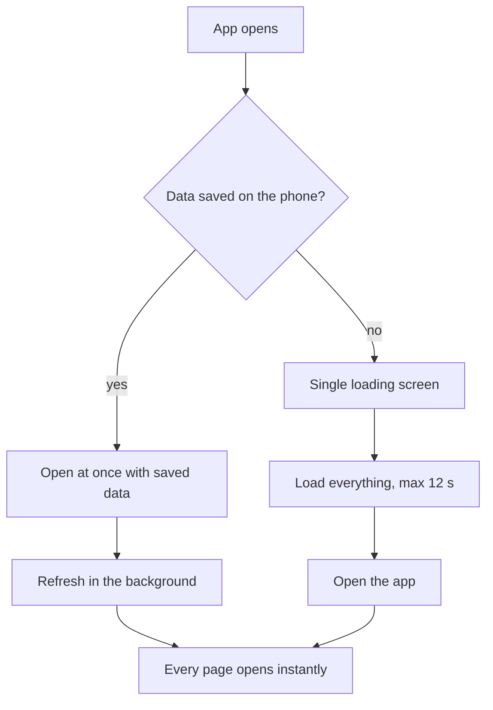

# App performance: cache and start-up preload

Related work: #214, PR #231.

## The problem

The app was slow everywhere: opening it, entering a garden and changing page.
Every screen waited for the server before showing anything.

The causes, found in the code:

| Cause                                                     | Effect                                                                                                                      |
| --------------------------------------------------------- | --------------------------------------------------------------------------------------------------------------------------- |
| Each screen loaded its data with `useState` + `useEffect` | Every time a page opened it started from an empty state and a spinner, even if the same data had been loaded seconds before |
| No cache shared between screens                           | Home, garden detail and sensor data asked the server for the same garden again and again                                    |
| Nothing saved on the phone                                | After closing the app nothing was left to show until the server answered                                                    |
| Start-up waited for the network                           | The app stayed on the login screen until the list of gardens arrived. With Render asleep this took up to ~50 s              |
| Requests one after the other                              | The garden screen made 3 requests in a row (garden → crops → sensors) instead of in parallel                                |
| Token read on every request                               | Each API call read the secure store 3 times (token, refresh token, username), which is slow on a phone                      |

## The solution

The goal was speed only: no change to screens, layout or behaviour.

1. **One shared cache** ([TanStack Query](https://tanstack.com/query)). Every
   screen reads the same cache. A page shows the data it already has at once
   and refreshes it from the server in the background.
2. **Cache saved on the phone** (AsyncStorage). When the app is opened again,
   every page has the last known data immediately.
3. **One loading screen at start-up.** The first time (or after logout) the
   app loads everything behind the existing loading screen: gardens, weather,
   devices, crops, sensors, tasks, profile and market. Afterwards every page
   opens instantly. It never waits more than 12 s: what is still missing keeps
   loading on its page.
4. **Prefetch.** When a garden is chosen, its data starts loading while the
   navigation animation runs. Market images are downloaded before they are
   shown.
5. **Parallel requests** on the garden screen.
6. **Token kept in memory** after the first read. It is read again only after
   login, token refresh or logout.



## Data is always real

Speed must not mean old data. Each kind of data has its own freshness
(`staleTime`): after that time the screen still shows the cached copy at once,
but asks the server again.

| Data                                          | Considered old after | Notes                                 |
| --------------------------------------------- | -------------------- | ------------------------------------- |
| Sensors, device status, weather alerts, stock | 5 s                  | Asked again every time the page opens |
| Weather                                       | 5 s                  | Also every 10 min while open          |
| Gardens, crops of a garden, tasks             | 30 s                 |                                       |
| Profile, AI recommendations, market           | 5 min                |                                       |
| Crop catalogue                                | 60 min               | Rarely changes                        |

On top of that:

- **After every change** (garden, device, crop, garden deleted) the API
  function marks the related data as old, so it is reloaded at once.
- **When the app comes back from the background**, the visible data is
  refreshed.
- **Logout or another user** empties the cache, in memory and on the phone.
- **Tokens are never cached**: they stay in the secure store.
- Saved data older than 24 h is discarded.

## Where it is in the code

All paths are in `agritwin-app/src`.

| File                            | What it does                                                         |
| ------------------------------- | -------------------------------------------------------------------- |
| `services/queryClient.ts`       | The single cache and its defaults                                    |
| `services/queryKeys.ts`         | Names of the cached data (garden data starts with `['field', id]`)   |
| `services/queries.ts`           | What to load and how fresh it must be; prefetch and start-up preload |
| `services/queryPersistence.ts`  | Saving the cache on the phone and clearing it                        |
| `services/cacheInvalidation.ts` | Marking data as old after a change                                   |
| `services/appFocus.ts`          | Refresh when the app returns to the foreground                       |
| `services/imagePrefetch.ts`     | Downloading market images in advance                                 |
| `hooks/use-cached-query.ts`     | `useCachedQuery`, refresh on screen focus, retry button              |
| `app/_layout.tsx`               | Start-up: saved gardens, single loading screen, preload              |

The data hooks (`use-field-weather`, `use-field-devices`, `use-field-crops`,
`use-field-recommendations`, `use-garden-tasks`, …) kept the same return
values, so the screens did not change.

## Adding new data (keep the app fast)

A screen written the old way still works, but that screen will be slow again.

1. Add the key in `services/queryKeys.ts`. Data of a garden starts with
   `['field', fieldId, ...]`.
2. Add the query in `services/queries.ts` with a `staleTime`: a few seconds
   if it must always be current, minutes if it rarely changes.

   ```ts
   export const irrigationQuery = (fieldId: number) =>
     queryOptions({
       queryKey: queryKeys.irrigation(fieldId),
       queryFn: () => getIrrigation(fieldId),
       staleTime: 30 * SECOND,
     });
   ```

3. Read it in the screen with `useCachedQuery` instead of
   `useState` + `useEffect` + `fetch`:

   ```ts
   const { data, isError } = useCachedQuery(irrigationQuery(fieldId));
   ```

4. In the API function that changes that data, call the right helper of
   `services/cacheInvalidation.ts` after the server accepts the change.
5. If the page is important, add the query to `fieldQueries` or `appQueries`
   in `services/queries.ts`, so it is preloaded.

Use `queryClient.query(...)` (not `fetchQuery` / `prefetchQuery`, which are
deprecated) when data is needed outside a component.

## Testing

- Unit tests cover the cache, persistence, invalidation, prefetch, start-up
  and the token in memory (`__tests__/unit/services/queryCache.test.ts`,
  `auth-cache.test.ts`, `__tests__/unit/app/root-layout.test.tsx`, …).
- `jest.setup.ts` empties the cache before and after every test.
- Speed must be checked on a **release** build: a development build is much
  slower because the code comes from Metro and is not optimised.

  ```bash
  npx expo run:android --variant release --device
  ```

## Notes

- `@react-native-async-storage/async-storage` is a native module: after
  pulling this change a **new development build or APK is needed**, otherwise
  the app closes at start-up.
- If `npm run typecheck` fails on routes such as `/field-selection`, the
  generated route types are old: delete `.expo/types` and run
  `npx expo start` once.
