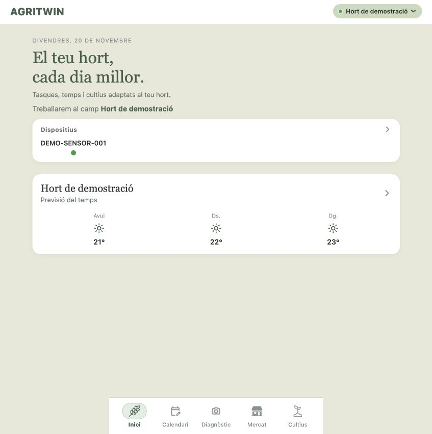
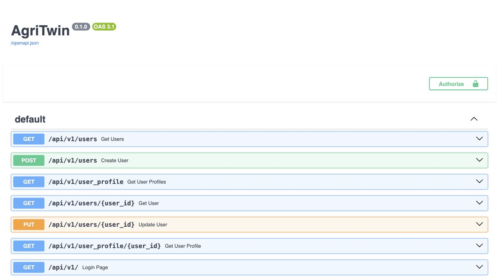
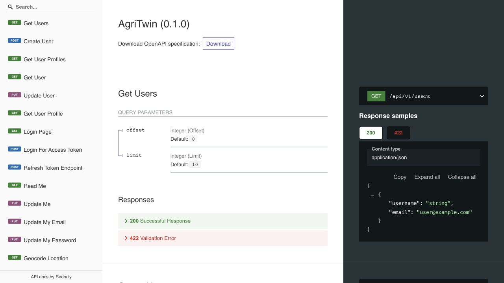

# AGRITWIN security remediation — 20 November 2026

**Status: the rated high and medium/moderate findings have fixes in the security branch and passed local regression checks. Deployment verification remains pending.**

Branch: `security/dev-review-5410a38`. Base commit: `5410a38fb8034cafd0374aef65761d8c9b069e21`. A fresh origin fetch confirmed the branch base matched `origin/dev` (0 ahead / 0 behind). These changes are prepared on the security branch for pull-request review and have not been deployed.

## Severity and remediation status

| Evidence source | Original severity and result | Current result | Status |
| --- | --- | --- | --- |
| npm audit | 5 high, 22 moderate affected package entries | 0 critical, 0 high, 0 moderate, 0 low | Requeried after the lockfile changes; [raw result](npm-audit-after.json) |
| OWASP ZAP 10038 | Medium: CSP missing on `/docs` | Fresh per-response nonces; restrictive documentation CSP without unsafe-inline or unsafe-eval | Fixed in code; unit and browser checks passed; deployment ZAP rerun pending |
| OWASP ZAP 10020 | Medium: anti-clickjacking header missing on `/docs` | `X-Frame-Options: DENY` and CSP `frame-ancestors 'none'` | Fixed in code; local checks passed; deployment ZAP rerun pending |
| OWASP ZAP 90003 | Medium: subresource integrity missing on `/docs` | Same-origin pinned assets with SHA-384 integrity attributes on JavaScript and CSS | Fixed in code; served bytes match integrity hashes; deployment ZAP rerun pending |
| OWASP ZAP 10021 | Low: missing nosniff header | `X-Content-Type-Options: nosniff` added to the actual backend middleware | Additional fix; checked with the real application TestClient |
| Agent review / OSV | 15 unrated preliminary code candidates; 5 unrated Python package matches | No new severity or exploit verdict assigned in this remediation | Remain pending independent validation; not counted as fixed or low risk |

The npm counts describe affected dependency entries, including inherited chain ratings; they are not 27 separate exploits. ZAP alert counts refer to deployment responses and must not be added to npm package counts. The original 16 low and 13 informational ZAP alerts have not been rescanned or declared closed.

## Dependency changes and compatibility

| Root package | Baseline scanner severity | Patched implementation | Compatibility protection |
| --- | --- | --- | --- |
| decode-uri-component | High | 0.5.1 | Exact upstream algorithm with only the default export adapted to CommonJS; tested through query-string and Metro |
| zod | High | 4.6.7 | Expo CLI plugin and MCP schemas tested with valid and invalid input |
| fast-uri | Moderate | 3.1.9 | Ajv schema resolution checked |
| glob | Moderate | 14.0.2 for affected ranges | Real Expo config-plugin sync/async glob use and cancellation checked |
| minimatch | Moderate | 11.0.1 for affected ranges | Expo fingerprint ignore patterns checked |
| stream-json | Moderate | Official 3.9.0 through a local CommonJS adapter | Used Detox and log-stream paths preserved; JSONL, array streams, real consumers and prototype safety checked |

Expo SDK 55, React Native and application screen/business logic versions are retained. Overrides are scoped to affected glob/minimatch/fast-uri ranges, preserving older unaffected APIs. The two local compatibility packages include source, licenses and [provenance](../../vendor/PROVENANCE.json); the official stream parser is installed through an npm alias. These are actual patched implementations, not audit exclusions.

`npm run test:security-dependencies` now runs after `npm ci` in the frontend unit-test and Sonar workflows. A new remote CI run has not been triggered. [Runtime versions](runtime-versions.json): Node 22.17.0 / npm 10.9.2; Python 3.13.7. Existing Expo runtime minimums still apply.

## API documentation changes

Swagger UI and ReDoc are hosted locally with pinned versions, licenses and [byte-for-byte upstream provenance](../../vendor/API-DOCS.md). `/docs`, `/redoc`, `/docs/oauth2-redirect` and `/openapi.json` retain their addresses. Proxy root paths are supported. CSP changes are limited to documentation HTML; application API payloads, authentication, session policy and CORS configuration retain their behavior.

Only the compiled third-party bundles are added to Sonar's dependency exclusions. Application Python remains analyzed. Local checks verify fresh nonces, frame restrictions, same-origin assets, SRI digests, root-path handling, traversal rejection, schema preservation, existing GET/HEAD ping behavior, unauthenticated `/api/v1/me` returning 401 and allowed CORS preflight.

## Tools used and observed results

| Tool | Execution in this remediation | Observed result |
| --- | --- | --- |
| npm audit | New registry advisory query after fixes | 0 vulnerabilities at every severity |
| pytest / FastAPI TestClient | Full local backend suite, including 9 new security regressions | 956 passed; 760 warnings; no failures — [log](backend-tests.txt) |
| pytest / locked framework | Full suite repeated with exact uv.lock FastAPI 0.143.0 and Starlette 1.7.0 wheels, verified against lockfile hashes | 956 passed; no failures — [log](backend-locked-framework-tests.txt) |
| Jest | Full local frontend suite | 1,169 tests, 130 suites passed; no failures — [summary](frontend-test-summary.json) |
| npm ci | Isolated copy, `--dry-run --ignore-scripts --offline` | Lockfile and local-tarball resolution accepted — [output](lockfile-consistency.txt); not a fresh full installation |
| Node consumer regression script | New compatibility checks | Passed — [log](dependency-compatibility.txt) |
| TypeScript | `npm run typecheck` | Passed |
| ESLint | `npm run lint` | 0 errors; 41 existing warnings — [log](frontend-lint.txt) |
| Ruff | Changed backend implementation and regression tests | Passed |
| Expo / Metro / Hermes | Android production export and web preview bundle | Android export passed — [log](android-export.txt); web UI rendered |
| Browser checks | Real login, garden selection and home screen with dummy local data; actual backend Swagger and ReDoc | Rendered successfully; documentation browser checks reported no console errors or warnings |
| OWASP ZAP | Previous CI evidence retained; no new deployment scan | 3 original medium alerts addressed in source; deployment verdict pending |
| SonarQube / SonarCloud | Previous CI evidence retained; compatibility check added to workflow | Previous gate OK, 0 vulnerabilities and 0 hotspots; changes not remotely rescanned |
| TruffleHog | Original scan retained; final PR filesystem snapshot also scanned | Original scan: 2 intentional rejection fixtures. PR snapshot: 7 false-positive hits, all the public Cloudflare methodology commit hash; no new leaked credential identified. Verification disabled — [PR evidence](pr-preflight-secret-scan.json) |
| Cloudflare security-audit skill | Original partial agent review retained; focused remediation agents used for documentation and preview | Original independent verification remains incomplete |
| BLA | Not executed | No BLA scan verdict exists; the original runtime constraint remains documented |

The initial browser/backend run used FastAPI 0.163.2 and Starlette 1.10.0. The full backend suite was subsequently repeated with the locked framework versions. Other Python packages came from the local environment; this was not a fresh `uv sync --frozen` installation.

[Machine-readable remediation summary](remediation-summary.json).

The original tool versions, execution boundaries, coverage gaps, scanner output and preliminary candidate details remain in the [baseline report](../../reports/2026-11-20-audit/REPORT.html). Local regression execution here used dummy configuration and provider fixtures; no production credentials or production data were used. This remediation does not complete the original Cloudflare independent-validation workflow.

## Application available for review

Open [the local application](http://localhost:8081). Username: `demo-local`. Password: `Demo-local-2026!`. `demo-new` uses the same dummy password and starts without a garden. These are disposable local fixtures.

Login, profile, fields, field crops and dashboard use actual routers and ORM with dummy SQLite records. Weather, geocoding and tasks are local fixtures; external backend provider connections are blocked. After map-preview feedback, the frontend was restarted with the normal public OpenStreetMap tiles instead of the optional offline grid. The user confirmed that the map then loaded; application map source was unchanged. Payments, social OAuth, AI and live-device integrations are not exercised by this preview. It does not establish production integration compatibility.

[Restart instructions](../../preview/README.md). Runtime data lives outside the repository, in the operating system temporary directory. The backend and frontend were left running for review.

## Remaining validation

Deploy these changes through the normal release process, then rerun ZAP against the resulting deployment and rerun Sonar/CI on the actual changed revision. Independently validate the 15 preliminary code candidates and retrieve full advisory severity/range evidence for the 5 Python package matches. No clean deployment scan, completed independent audit, native-device test or all-integrations verdict is claimed here.
